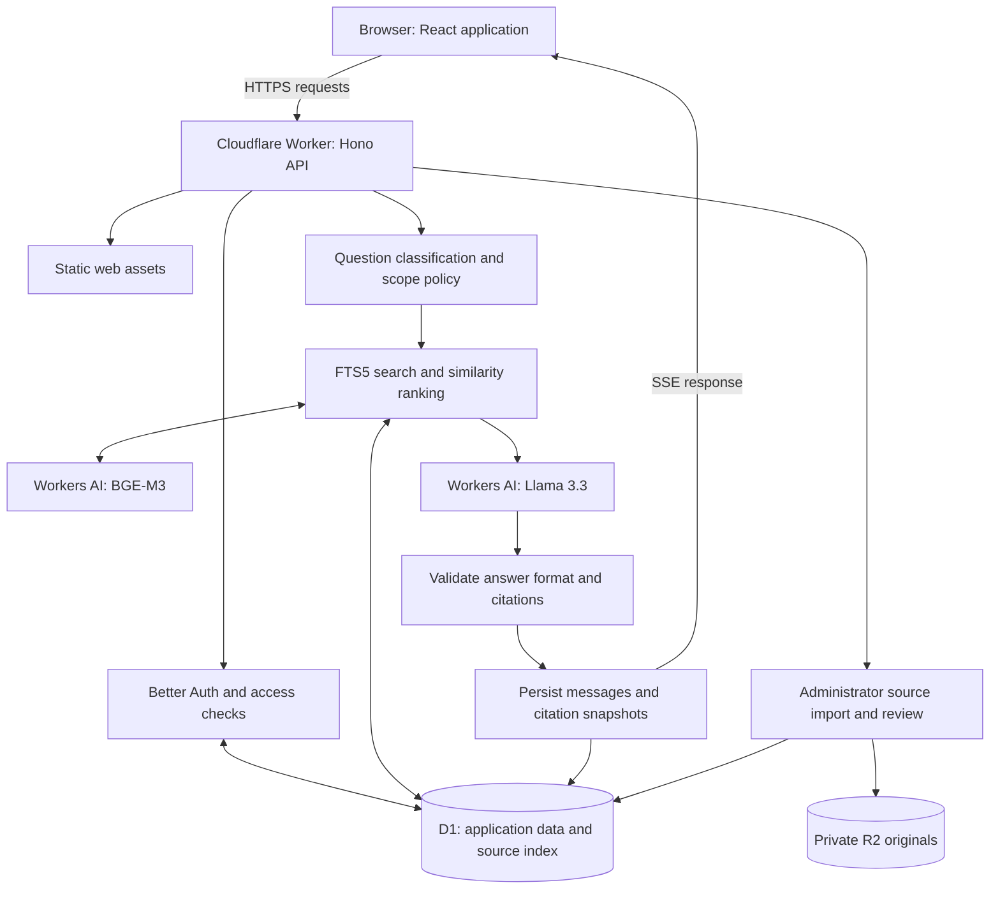

# SJN AI — Technical Overview and Working Flow

**Prepared for:** Senior engineering review\
**Date:** 28 October 2026\
**Status:** Deployed web beta; educational scope\
**Application:** [SJN AI](https://sjn-ai-beta.algobee-solutions.workers.dev)

## 1. Project introduction

SJN AI is a web application for source-guided Islamic learning in **Urdu, English and Roman Urdu**. Users register, complete adult onboarding, ask questions, inspect supporting passages and revisit saved conversations. Administrators manage source imports, review and publication through Source Studio.

The current scope covers **Aqaid, Akhlaq and other supported Islamic educational subjects**. Marja selection and Fiqh rulings are paused. The application is an educational assistant; its answers require appropriate scholarly review.

## 2. Which AI models are used?

The deployed application calls models through the Cloudflare Workers AI binding, `env.AI.run()`.

| Purpose           | Configured model                                                                       | Role                                                                                                                   |
| ----------------- | -------------------------------------------------------------------------------------- | ---------------------------------------------------------------------------------------------------------------------- |
| Answer generation | **Meta Llama 3.3 70B Instruct, FP8 Fast** — `@cf/meta/llama-3.3-70b-instruct-fp8-fast` | Produces a structured answer from the question and retrieved evidence; also supplies Urdu search keywords when needed. |
| Embeddings        | **BAAI BGE-M3** — `@cf/baai/bge-m3`                                                    | Converts questions and candidate passages into 1,024-dimensional vectors for similarity ranking.                       |

Answer generation uses JSON output, temperature **0.1**, and a maximum of **1,800 output tokens**. These are application settings. Model references: [Cloudflare Llama documentation](https://developers.cloudflare.com/workers-ai/models/llama-3.3-70b-instruct-fp8-fast/) and [BGE-M3 documentation](https://developers.cloudflare.com/workers-ai/models/bge-m3/).

The procedure is **retrieval-augmented generation (RAG)**: selected source passages are supplied at request time, while model weights remain unchanged.

An embedding is a numerical representation used to compare relevance. The application sends the selected text passages to Llama, which writes an explanation in the requested language. The complete source collection is stored in the application's data services; only the selected evidence enters each answer prompt.

## 3. Hosted architecture

| Component           | Technology and responsibility                                                                                                   |
| ------------------- | ------------------------------------------------------------------------------------------------------------------------------- |
| Web interface       | React, TypeScript and Vite; responsive chat, authentication, preferences and Source Studio.                                     |
| Application backend | A Cloudflare Worker using Hono; serves static assets and `/api/*` routes on the same origin.                                    |
| Authentication      | Better Auth; email/password accounts, sessions and access checks.                                                               |
| Database            | Cloudflare D1: accounts, profiles, conversations, messages, source metadata, passages, FTS5 search index and cached embeddings. |
| Original files      | Private Cloudflare R2 storage; used during source ingestion and reprocessing.                                                   |
| AI inference        | Cloudflare Workers AI: BGE-M3 embeddings and Llama answer generation.                                                           |

The preserved local variant uses the same frontend with **Express and MongoDB**. Its configurable OpenAI-compatible provider defaults to `gpt-4.1-mini` and `text-embedding-3-small` when credentials are supplied. The hosted request path uses the Cloudflare models above.

## 4. How a question travels through the application

1. **Submit:** The browser creates or opens a conversation, then sends `POST /api/conversations/:id/messages` with the question, a request ID and the session cookie.
2. **Authorize:** The Worker checks the request origin, CSRF header, input schema, authenticated session, completed onboarding and conversation ownership. Request IDs support replay without duplicate answers; a conversation lease prevents simultaneous generation.
3. **Apply policy:** A deterministic classifier selects the topic and answer language. Recognized Fiqh questions receive predefined guidance before retrieval or model generation.
4. **Find candidates:** Search is restricted to approved `EDUCATIONAL / JAWAD_NAQVI` sources. Recognized topics add a topic filter; general educational questions search across eligible topics. Urdu aliases help common English/Roman Urdu queries; unfamiliar Latin-script queries may receive model-generated Urdu keywords. D1 FTS5 selects up to **12** candidates using BM25 ranking.
5. **Rank evidence:** BGE-M3 embeds the question and any candidates without current cached embeddings. The Worker computes cosine similarity, applies a **0.45** minimum score, and keeps up to **five** passages. Missing embeddings are cached in D1.
6. **Generate:** Llama receives the question, language, topic, selected evidence and up to four preceding user messages. The prompt requires source-supported explanations. Missing evidence produces an explicit insufficient-evidence response without answer generation.
7. **Validate and save:** Zod checks the output structure. Citation IDs must belong to retrieved evidence; any returned quotes must match source text. Source approval is checked again before the question, answer and citation snapshots are saved together.
8. **Display:** The browser receives the answer and renders expandable citation cards. The current server-sent events (SSE) response carries a completed, validated answer after persistence; incremental model-token streaming is a future improvement.

Source websites are accessed during ingestion. Chat requests search the prepared index.

For example, a question about **honesty** gains the search aliases **سچائی / صداقت**. The backend finds and ranks eligible passages, supplies the strongest matches to Llama, validates the returned citation IDs, and displays the explanation alongside the original evidence.

## 5. How much data is stored, and where?

The first collection comes from the [Syed Jawad Naqvi website](https://www.syedjawadnaqvi.com/). Counts were reconfirmed on 28 October 2026.

| Data                       | Quantity and storage                                                                                                |
| -------------------------- | ------------------------------------------------------------------------------------------------------------------- |
| Collected website texts    | 1,466 archived locally; excluded from GitHub.                                                                       |
| Excluded texts             | 126 exact duplicates and 9 publisher forewords/table-of-contents entries.                                           |
| Approved source documents  | **1,331**, with title, URL, attribution, version, approval state and file reference in D1's `sources` table.        |
| Imported text originals    | **1,331 private R2 objects**, approximately **112.4 MiB** at initial verification.                                  |
| Searchable passages        | **31,331** in D1's `chunks` table; normalized search text is indexed through FTS5's `chunk_search` table.           |
| Embedding cache            | Candidate vectors and model IDs are stored on demand in D1; the complete corpus does not need embedding before use. |
| Accounts and conversations | Better Auth records, profiles, messages and citation snapshots are stored in D1.                                    |

The recorded D1 database size was approximately **302.1 MiB**, including source passages, indexes and application tables. Both storage sizes are historical snapshots from **24 October 2026**, not fresh live measurements; they grow with usage. See the [indexing report](docs/SOURCE_INDEXING.md).

Recording links are cataloged without searchable transcripts. The archive contained no discoverable PDFs; the uploader supports readable PDF, TXT and Markdown files.

The preparation flow is:

**Collect authorized material → preserve originals and provenance → check extraction and duplicates → split into passages → build the search index → review → approve for retrieval.**

Hosted extraction uses passages of up to **2,400 characters**, with **240-character overlap**. Original wording is preserved separately from normalized search text. Unpublished sources are excluded from future answers; historical citation snapshots remain attached to saved conversations.

The existing corpus received automated technical review with sampled inspection. Approval is a retrieval state; it does not establish scholarly certification or an independently verified copyright license.

## 6. Controls, verification and review priorities

- **Access and privacy:** Secure/HttpOnly session cookies, origin checks, user/admin roles and conversation ownership checks. Questions, selected passages and limited history are processed by Workers AI. Credentials and source archives remain outside Git; R2 originals are private.
- **Availability:** Chat limits are 15 attempts per minute per user and 200 daily attempts across the beta. Cloudflare quotas also apply. Recognized D1 daily-limit errors return HTTP 503 with `Retry-After`; a read-only readiness check does not prove writes are available.
- **Verified release:** Twelve Worker integration tests and release CI passed. Live checks covered login, multilingual answers, Fiqh deferral and desktop/mobile UI. All 15 sampled citations matched approved passages exactly.
- **Google sign-in:** Enabled on the hosted beta on 30 October 2026 using the `algobee-sjn-ai` Google Cloud project. The client secret is stored as a Cloudflare Worker secret; existing password accounts connect Google explicitly in preferences.
- **Pending integrations:** Email verification/recovery delivery and the permanent account/domain remain pending. The beta is excluded from search-engine indexing.
- **Review priorities:** Evaluate scholarly accuracy, multilingual retrieval recall and the similarity threshold; test load, latency and quota budgets; rehearse backup restoration; review source rights and retention. Keyword classification and citation checks cannot guarantee every generated claim is supported. Durable ingestion jobs remain a scaling consideration.

## 7. Implementation references

| Area                             | Repository reference                                                      |
| -------------------------------- | ------------------------------------------------------------------------- |
| Models and retrieval             | [apps/worker/src/ai.ts](apps/worker/src/ai.ts)                            |
| Request handling and persistence | [apps/worker/src/index.ts](apps/worker/src/index.ts)                      |
| Answer policy and validation     | [apps/api/src/rag/generator.ts](apps/api/src/rag/generator.ts)            |
| Source ingestion                 | [apps/worker/src/sources.ts](apps/worker/src/sources.ts)                  |
| Deployment and verification      | [Deployment guide](docs/DEPLOYMENT.md), [testing record](docs/TESTING.md) |
