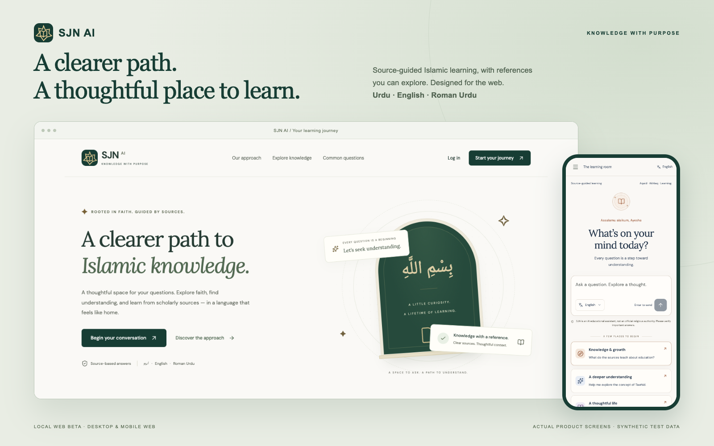
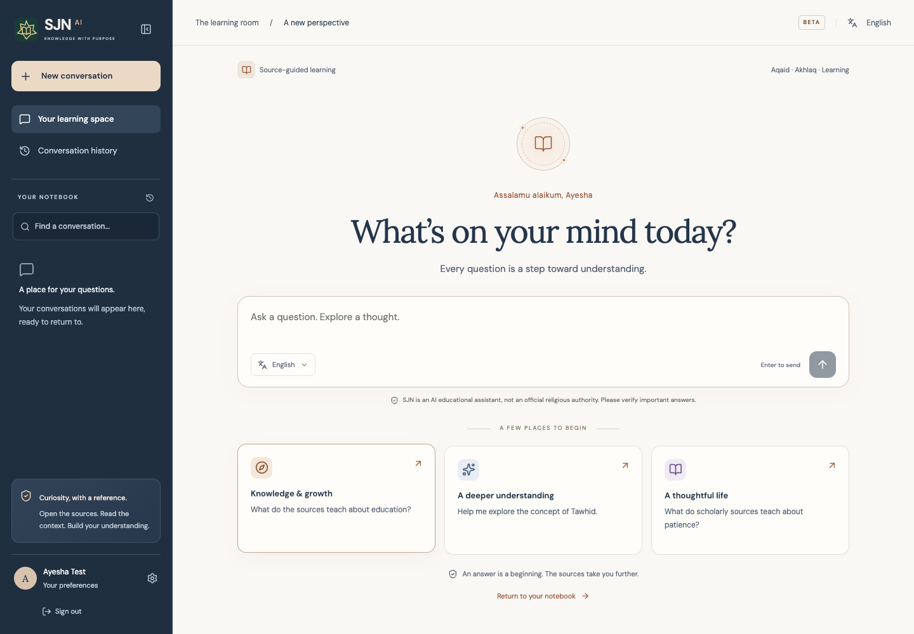
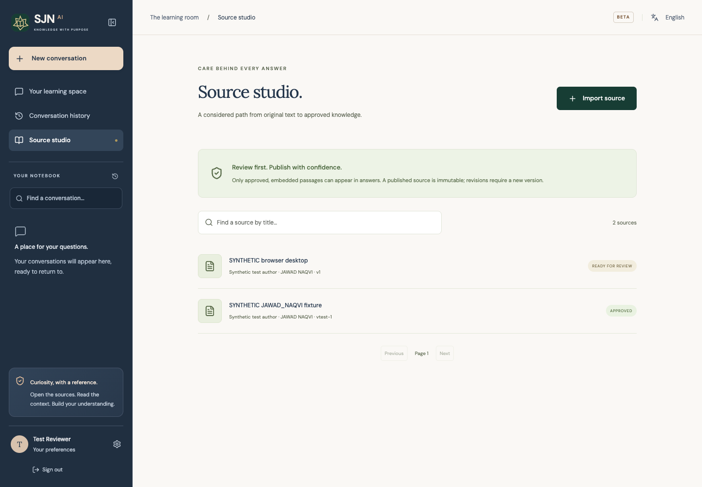
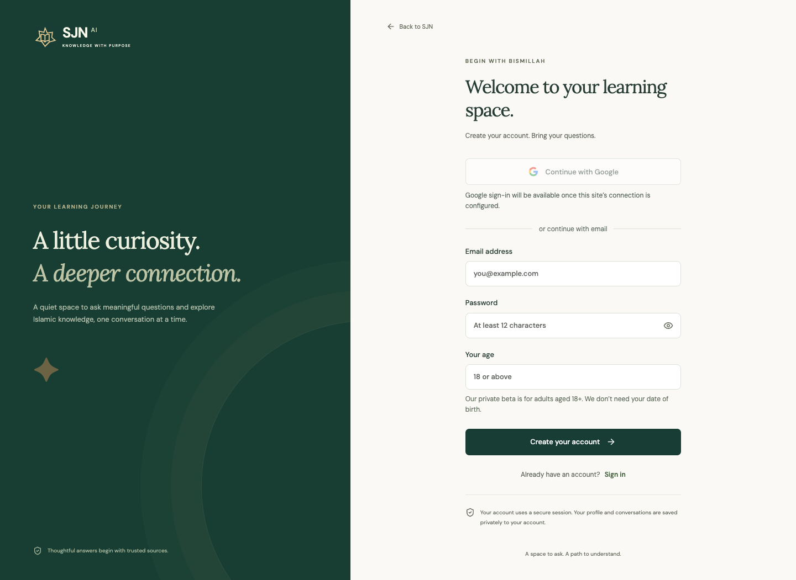
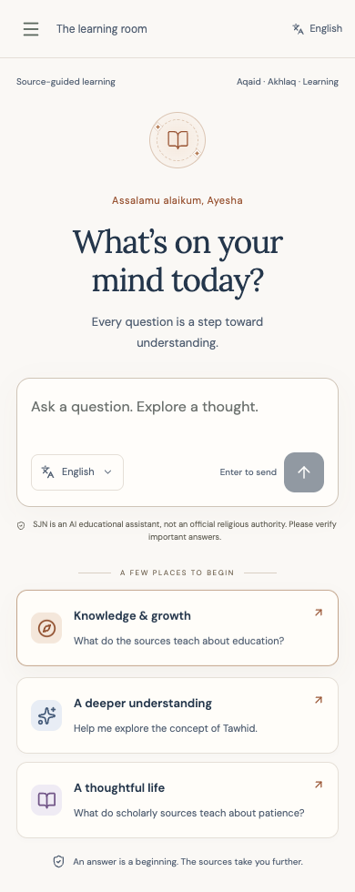
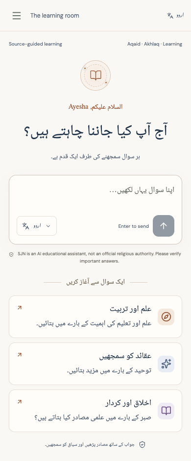
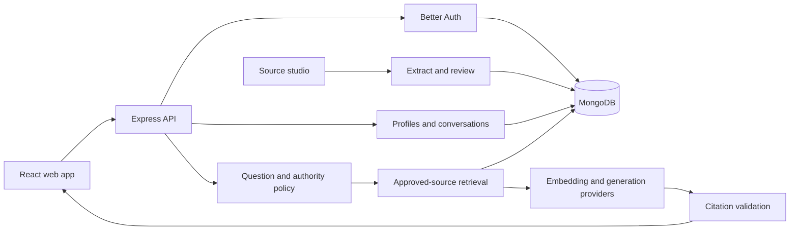

<div align="center">
  
  <h1>SJN AI</h1>
  <p><strong>Knowledge with purpose.</strong><br />A thoughtful space for source-guided Islamic learning.</p>
  <p><strong>Web beta</strong> · React + TypeScript · Cloudflare Workers + D1 · Local MongoDB · Better Auth</p>
  <p><a href="#quick-start">Run locally</a> · <a href="#product-preview">Product preview</a> · <a href="docs/ARCHITECTURE.md">Architecture</a> · <a href="docs/AUTHENTICATION.md">Google sign-in</a></p>
</div>



SJN brings a source-governed learning workspace, inspectable references, personal learning preferences, and an editorial review workflow into one web application. It supports **Urdu, English, and Roman Urdu**, with a responsive interface and right-to-left Urdu layouts.

**Current status:** deployed web beta at [sjn-ai-beta.algobee-solutions.workers.dev](https://sjn-ai-beta.algobee-solutions.workers.dev). The hosted app uses a dedicated Cloudflare Worker, D1, private R2 and Workers AI. Email/password login, profiles, history and source review are implemented. Google OAuth awaits credentials. The hosted educational index contains 1,331 technically reviewed SJN website texts and 31,331 cited passages; see the [review scope and indexing report](docs/SOURCE_INDEXING.md). The original local Express/MongoDB app is preserved. See the [deployment and account-migration guide](docs/DEPLOYMENT.md).

> SJN is an educational companion, not an official religious authority or a substitute for a qualified scholar. The normal database contains no preloaded religious sources or invented answers. Preview accounts and source records below are synthetic test fixtures.

**Release scope:** educational-only, with Marja-free onboarding and explicit Fiqh deferral. Existing preferences, sources and historical citations are preserved. See [educational scope](docs/EDUCATIONAL_SCOPE.md).

## What you can do

- **Learn in your language.** Choose Urdu, English, or Roman Urdu, with a responsive desktop and mobile workspace.
- **Follow the evidence.** Inspect citations, original passages, source URLs, and publication details.
- **Explore Aqaid, Akhlaq and Islamic education.** Answers use approved educational sources with clear attribution. Fiqh rulings and Marja selection are paused in the current source tree.
- **Return to your conversations.** Save, rename, and revisit history while keeping earlier citation snapshots intact.
- **Sign in securely.** Better Auth provides email/password accounts, Google OAuth, explicit account linking, and session revocation.
- **Review before publishing.** Administrators import authorized PDF, TXT, or Markdown files, inspect extraction, and approve material before it can be retrieved.

## Product preview

These are screenshots of the implemented application, captured from the isolated browser-test database. The cover adds presentation frames; it does not represent an additional native mobile app.

The learning room uses ink-blue navigation, warm paper surfaces and copper accents. A collapsible sidebar, searchable recent conversations, mobile navigation drawer and expandable citations keep questions and their sources easy to revisit. The composer appears before starter questions and stays within reach during a conversation. These previews reflect the local frontend; the hosted beta updates separately on deployment.

| Learning workspace                                                                          | Source studio                                                                                                                |
| ------------------------------------------------------------------------------------------- | ---------------------------------------------------------------------------------------------------------------------------- |
| [](docs/images/chat-desktop.png) | [](docs/images/admin-desktop.png) |

<details>
<summary><strong>See authentication and mobile previews</strong></summary>



<p align="center">
  
  &nbsp;&nbsp;
  
</p>

[Full public landing page](docs/images/landing-desktop.png) · [Preview provenance and regeneration](docs/images/README.md)

</details>

## Quick start

Requires **Node.js 22.18+** and **pnpm 10.28.2**. The first install/start needs internet to download dependencies and the development MongoDB binary.

From your local checkout:

```sh
npx --yes pnpm@10.28.2 install --frozen-lockfile
npx --yes pnpm@10.28.2 dev
```

Open **http://localhost:5173**. Create an account, complete adult onboarding, and explore the workspace.

Without a `MONGODB_URI`, the launcher starts a persistent local MongoDB on port `27018`. Its data and generated development auth secret stay in the ignored `.local/` directory. The API listens on `127.0.0.1:3001`. Use the same browser hostname throughout authentication.

No AI or Google credentials are required to explore email authentication, preferences, history, or source review. The app explains when an integration is not configured.

### Connect optional services

Copy `.env.example` to `.env` and fill in only the services you need:

| Service                      | Server-side configuration                                                                             | Guide                                                        |
| ---------------------------- | ----------------------------------------------------------------------------------------------------- | ------------------------------------------------------------ |
| Google sign-in               | `GOOGLE_CLIENT_ID`, `GOOGLE_CLIENT_SECRET`; callback `http://localhost:5173/api/auth/callback/google` | [Authentication](docs/AUTHENTICATION.md)                     |
| AI generation and embeddings | `OPENAI_API_KEY`, `OPENAI_BASE_URL`, `LLM_MODEL`, `EMBEDDING_MODEL`                                   | [Local development](docs/LOCAL_DEVELOPMENT.md#configure-ai)  |
| External MongoDB             | `MONGODB_URI`                                                                                         | [Local development](docs/LOCAL_DEVELOPMENT.md#start-locally) |
| Persistent auth secret       | `BETTER_AUTH_SECRET` — generate a random value of at least 32 characters                              | [Authentication](docs/AUTHENTICATION.md)                     |

When copying the example, remove its `MONGODB_URI` line if you want to keep using the automatic local database. Replace the example auth-secret placeholder, then restart the app. Never put secrets in `VITE_` variables or commit `.env`.

To create a reviewer account and import your first authorized source, follow [administrator setup](docs/LOCAL_DEVELOPMENT.md#bootstrap-an-administrator) and [source governance](docs/SOURCE_GOVERNANCE.md).

## Architecture

The diagram below describes local development. The hosted variant serves the same client/API contracts from Workers, stores accounts and conversations in D1, originals in private R2, and uses Workers AI. Shared authority and answer-validation policy serves both variants.



| Layer                  | Implementation                                                                   |
| ---------------------- | -------------------------------------------------------------------------------- |
| Interface              | React 19, TypeScript, Vite, Tailwind CSS, Radix UI, React Router, TanStack Query |
| API and authentication | Express 5, Better Auth, Argon2id, Zod                                            |
| Persistence            | MongoDB, Mongoose, persistent development database                               |
| Retrieval              | Authority-scoped local cosine search, pluggable embeddings, validated citations  |
| Verification           | Vitest, Supertest, Playwright, axe accessibility checks                          |

```text
apps/web/             Public site, onboarding, learner workspace, source studio
apps/api/             Preserved local Express/MongoDB backend and tests
apps/worker/          Hosted Workers/D1/R2 backend, migrations and runtime tests
packages/shared/      Shared validation schemas and application types
scripts/              Local launcher, admin setup, publishing audit, mockup capture
tests/e2e/            Desktop/mobile journeys and disposable synthetic fixtures
docs/                 Architecture, operations, security boundaries and previews
```

## Development and verification

Use `pnpm` directly if installed, or substitute `npx --yes pnpm@10.28.2`.

```sh
pnpm repo:check       # Check publishable files for tracked ignores and credential patterns
pnpm lint
pnpm typecheck
pnpm test            # Unit/API tests with disposable MongoDB
pnpm test:worker     # Isolated workerd/D1/R2 integration tests
pnpm check:cloudflare # Build and validate the hosted deployment without uploading
pnpm test:e2e        # Desktop/mobile Chrome journeys and accessibility checks
pnpm build           # Web build, public-page prerendering and API compilation
pnpm docs:mockups    # Rebuild public previews from the synthetic E2E screenshots
```

Browser tests use installed Google Chrome, ports `5174`/`3002`, and a disposable database. See [testing](docs/TESTING.md) for setup, coverage, recorded results, and the production smoke check. The GitHub Actions workflow runs repository checks, lint, type checking, tests, and the build; no badge claims a remote result before that workflow has run in your repository.

## Documentation

| Guide                                          | Covers                                                          |
| ---------------------------------------------- | --------------------------------------------------------------- |
| [Local development](docs/LOCAL_DEVELOPMENT.md) | Configuration, admin bootstrap, source import, useful commands  |
| [Authentication](docs/AUTHENTICATION.md)       | Better Auth, Google setup, sessions, existing-account migration |
| [Architecture](docs/ARCHITECTURE.md)           | Data model, security boundaries, persistence and trade-offs     |
| [RAG pipeline](docs/RAG_PIPELINE.md)           | Classification, retrieval, generation and citation validation   |
| [Source governance](docs/SOURCE_GOVERNANCE.md) | Rights, editorial review, provenance and publication            |
| [Source extraction](docs/SOURCE_EXTRACTION.md) | Reproducible local website archive, coverage and review handoff |
| [API](docs/API.md)                             | Authentication, profiles, conversations, source studio and SSE  |
| [Testing](docs/TESTING.md)                     | Automated checks and what still requires live evaluation        |
| [GitHub publishing](docs/PUBLISHING.md)        | Private files, repository audit and a clean first push          |
| [Deployment](docs/DEPLOYMENT.md)               | Cloudflare options and hosted-beta requirements                 |
| [SEO and AEO](docs/SEO_AEO.md)                 | Prerendering, structured content and indexing controls          |
| [Roadmap](docs/ROADMAP.md)                     | Current scope and future work                                   |

## Scope and responsible use

The beta is for adults aged 18 and over. It is not a production certification. Live model behavior, authentic source quality, and religious interpretation require evaluation with your provider credentials and qualified reviewers. Google OAuth is tested with isolated provider responses; live consent must be checked using your Google project.

Email verification/recovery delivery, distributed jobs and outer rate limits, durable hosted uploads, OCR, and a managed deployment remain future work. Source permissions and third-party licenses must be respected. No project-wide open-source license has been selected yet.
