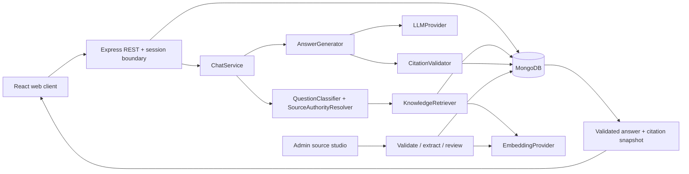

# Architecture and decisions

## Boundaries

The client consumes version-0.1 JSON REST endpoints and SSE over HTTP. Authority routing, approval checks, retrieval, model credentials, answer policy and provenance live on the server. Mobile clients can reuse these contracts; cookie/CSRF handling would need an explicit native-client authentication design before mobile release.

## Data model

| Collection     | Purpose and indexes                                                                                                                                              |
| -------------- | ---------------------------------------------------------------------------------------------------------------------------------------------------------------- |
| User           | Profile with the auth identity ObjectId, unique email, nullable age until adult onboarding, preferences and server-owned role                                    |
| Better Auth    | authUsers, authAccounts (Argon2id credentials/encrypted OAuth tokens), authSessions (TTL), authVerifications (TTL)                                               |
| Conversation   | Indexed owner/update time, deletion tombstone, per-conversation generation lease                                                                                 |
| Message        | Indexed conversation/chronology, unique conversation/request/role for retry deduplication, content and immutable answer provenance                               |
| SourceDocument | Versioned metadata, author, category, authority, original URL, SHA-256 upload hash, upload/reviewer metadata and approval state; compound authority/status index |
| SourceChunk    | Original text, separate normalized text, PDF page, supplied section/ruling, vector/model identity; unique document/chunk index                                   |
| IngestionJob   | Source processing state, errors and completion time                                                                                                              |
| AuditLog       | Administrator, source action, resource and timestamp; no passwords, prompts or model secrets                                                                     |

## Security

Better Auth owns email/password and Google OAuth authentication through its official MongoDB adapter. Argon2id hashes remain compatible with legacy accounts. Signed HttpOnly SameSite=Lax cookies support OAuth callbacks; Secure cookies and HTTPS are required in production. Sessions live in Better Auth collections, with cookie caching disabled for immediate revocation. No localStorage tokens. Native auth requests enforce allowed origins and Better Auth CSRF/state/PKCE checks; custom business writes require an exact Origin plus `X-SJN-Request: 1`. API and app share an origin through the proxy; no permissive CORS. Explicit Google linking requires an authenticated owner and matching email. See [authentication](AUTHENTICATION.md) for migration and configuration.

Every conversation operation checks ownership. Source routes require an authenticated server-side ADMIN role. Public registration never accepts a role. Zod strips unsupported source metadata and rejects unknown profile fields. JSON/body/file sizes are bounded. Uploads use generated storage names, not client paths; files are not served publicly. Only text/PDF formats are accepted. Helmet headers, safe Markdown without HTML, validated HTTPS citation URLs, no browser-rendered source HTML, request IDs and sanitized error logging complete the baseline.

The outer account and chat limiters are process-local; Better Auth also uses database-backed rate limiting. Do not enable proxy trust indiscriminately. When hosting, configure the exact proxy topology and a shared rate-limit store. Current deployment model is one API process; startup marks interrupted ingestion jobs failed. Do not horizontally scale this recovery model without a distributed job lease.

## Persistence and concurrency

The development launcher uses a real MongoDB binary with WiredTiger and a persistent local dbPath. Tests use separate disposable databases. An optional user-supplied MongoDB URI bypasses the automatic process.

A five-minute database lease serializes generation per conversation. Request IDs allow retrying a completed response without duplicating messages. The complete answer is generated and verified before persistence and SSE delivery. User and assistant writes are separately atomic, not a cross-collection transaction: a crash between writes may leave a user-only message. The normal retry path repairs this using the same request ID. Conversation deletion is forbidden during an active generation lease; messages are deleted after the conversation is tombstoned.

## Deliberate trade-offs

Local cosine search loads at most 5,000 matching chunks, keeping the first vertical slice simple and auditable. Atlas Vector Search is not implemented; invalid backend configuration fails validation rather than pretending it is active. Published vectors are pinned to their embedding model. Changing models requires new document versions. Filesystem upload storage and native Argon2/PDF dependencies keep this a Node application; they are not directly interchangeable with a Worker runtime. See deployment decisions before hosting.

The client uses small owned shadcn-style Button/Dialog components with Radix accessibility primitives and Tailwind's Vite integration, plus a custom visual system. Bundled font assets remove third-party font requests. The public page is prerendered during production build; private app data never participates in prerendering.
